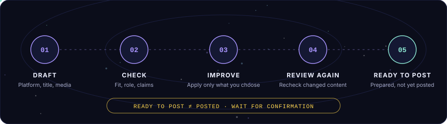
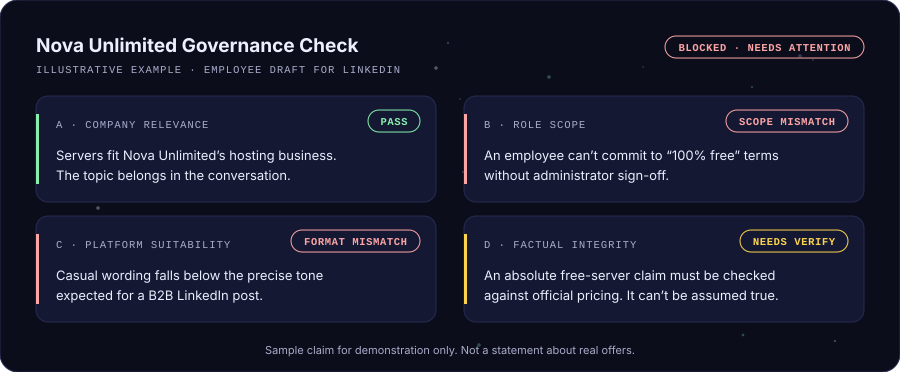

  
Every brand has a standard. Make every post count.

An AI-powered brand governance workspace for reviewing content against company context, role permissions, and publishing guidelines.

    
 
  
 <!-- Replace the href below with your real hosted application URL. --> <!--  -->  <a href="#mission"><b>Mission</b></a> &nbsp;·&nbsp; <a href="#capabilities"><b>Capabilities</b></a> &nbsp;·&nbsp; <a href="#flight-path"><b>Flight path</b></a> &nbsp;·&nbsp; <a href="#governance"><b>Governance</b></a> &nbsp;·&nbsp; <a href="#architecture"><b>Architecture</b></a> &nbsp;·&nbsp; <a href="#security"><b>Security</b></a> &nbsp;·&nbsp; <a href="#launch"><b>Launch</b></a>   

✦ Mission brief

BrandLens helps teams create content that fits the company, the author's role, and the intended platform, before it goes live.

Instead of checking spelling alone, BrandLens considers the bigger picture: Is this content relevant to the organization? Is the author allowed to make this announcement or commitment? Are the message and media consistent with the configured guidelines and available facts?

The current demo workspace is configured for Nova Unlimited, a server and hosting provider. The governance configuration is designed to be adapted for other organizations.

The four questions every draft faces
	BrandLens asks	Why it matters
01	Does it fit the company?	The post should relate to the organization's configured business and services.
02	Is the author allowed to say it?	A commitment may need more authority than the author's role holds.
03	Is it right for the platform?	Tone and format should suit the audience, such as professional B2B on LinkedIn.
04	Can the claim be supported?	Unsupported claims are flagged for verification, never invented or assumed.
text
┌──────────────────────────────────────────────────┐
│  BRANDLENS // MISSION CONTROL                    │
│  ──────────────────────────────────────────────  │
│  ▸ COMPANY CONTEXT .......... LOADED             │
│  ▸ ROLE SCOPE ............... ENFORCED           │
│  ▸ UNSUPPORTED CLAIMS ....... FLAGGED TO VERIFY  │
│  ▸ HUMAN IN THE LOOP ........ ALWAYS             │
└──────────────────────────────────────────────────┘

⚡ Capabilities
Capability	What it does
◈ Company-aware review	Checks whether a post relates to the organization's configured business and services.
◈ Role-aware governance	Evaluates content against the author's assigned responsibilities and permissions.
◈ AI text review	Reviews titles and captions, explains meaningful concerns, and suggests practical corrections.
◈ Image analysis	Reviews visual content in the context of the proposed post.
◈ AI image generation	Creates a concise visual prompt from post context and sends it to the configured image-generation service.
◈ Review workflow	Tracks content through review, correction, and ready-to-post states.
◈ Post history	Keeps saved posts, review outcomes, and relevant activity available for later reference.
◈ Social publishing	Supports the configured account-connection and publishing workflow when platform credentials, permissions, and account authorization are in place.
✦ Enhancer  NEW	A separate tab of focused tools: Text Review, Image Review, Image Generate, and PDF/DOCX Text Extract.

🧭 Flight path: how the review works

  
  
Draft: choose a platform and add the title, caption, and media.
Check: review company relevance, role scope, content quality, and supported claims.
Improve: inspect suggested corrections and apply only the changes you choose.
Review again: recheck changed content so old findings do not masquerade as current results.
Prepare to publish: use the connected publishing workflow when the account and platform permissions are configured.

[!IMPORTANT] Ready to Post is not the same as Posted. A post should only be marked published after the applicable publication has actually been confirmed.

🛡️ Governance by context

"Relevant to the company" is not the same as "safe to publish". One draft can pass one check and fail another, and BrandLens shows each reason separately so the author fixes the right thing: topic, authority, tone, or evidence.

  
  

The current Nova Unlimited starter configuration distinguishes between three workspace roles:

Role	Scope
👤 Employee	Product-level and operational content within assigned authority.
🧑‍💼 Manager	Campaigns, team initiatives, project updates, and management-level communications within assigned authority.
🏛️ Administrator	Organization-wide messaging and approved corporate communications within assigned authority.

These are configurable starter guidelines for the current demo organization, not universal rules for every company. BrandLens should flag unsupported claims for verification rather than inventing facts or pretending uncertain information is verified.

🧱 Architecture at a glance

BrandLens combines a web workspace with server-side AI integrations and persistent post/task data. The exact framework and deployment-specific services are defined by the source code and environment configuration in this repository.

Layer	Role
🖥️ Web experience	Landing page, authenticated workspace, post editor, review states, history, and Enhancer tools.
🧠 AI services	Configured text/multimodal review and image-generation integration.
🧭 Governance context	Organization facts, company guidelines, role scopes, and platform selection.
💾 Persistence	Saved posts, media references, review results, and activity/task records supported by the configured backend.
📡 Publishing	Platform-specific OAuth and API permissions must be configured before real publication is available.

🔐 Configuration & security
✔ Keep AI API keys, OAuth client secrets, access tokens, and encryption keys on the server.
✔ Use environment variables or your hosting provider's secret manager for private configuration.
✔ Do not commit .env files, credentials, private tokens, or real customer data.
✔ Keep a safe .env.example with placeholder values only.
✔ Social publishing requires the relevant developer application, callback URL, permissions, and authorized account.
✔ Do not describe a platform as connected or a post as published unless the application has confirmed that state.

🚀 Launch sequence
Clone this repository.
Install dependencies using the package manager indicated by the committed lockfile.
Configure the server-side environment variables required by the project. Use a safe .env.example as the reference and keep real secrets out of Git.
Start the frontend and backend using the development scripts defined by the repository.

[!NOTE] Exact commands depend on the current project configuration. Use the scripts and deployment settings in this repository as the source of truth.

📘 Documentation

The complete walkthrough of the workspace, the Nova Unlimited examples, content review, and the Enhancer tab is available as a PDF.

📖 Read the guide online  ·  ⬇ Download the PDF

 
✨ Project principles
Principle	In practice
Context over keywords	Evaluate the meaning of a post, not just isolated words.
Explainable review	Show useful reasons and actionable corrections.
Human decisions	Suggestions assist the author; they are not a substitute for required company approval.
Safe integration	Keep API keys and social tokens on the server.
One source of truth	Saved posts, review results, and workflow states stay consistent across the app.
🤝 Contributing

Contributions and practical feedback are welcome. Before proposing a change, please preserve the existing governance rules, avoid exposing secrets, and include a brief description of the behaviour being changed.

  
  
 <!-- Maintainer checklist before publishing this README: 1. Replace the commented live-app link with the real hosted URL. 2. Add real screenshots or a short demo GIF to assets/ when available. 3. Replace generic setup guidance with commands verified against this repository. 4. Confirm which social integrations are actually available in production. 5. Keep brandlens-banner.gif and brandlens-banner.png in assets/ (the README references the GIF). -->
